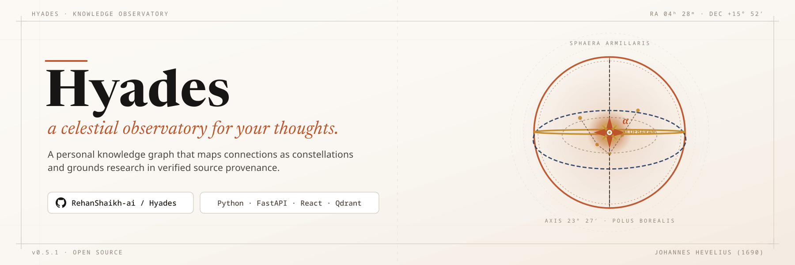
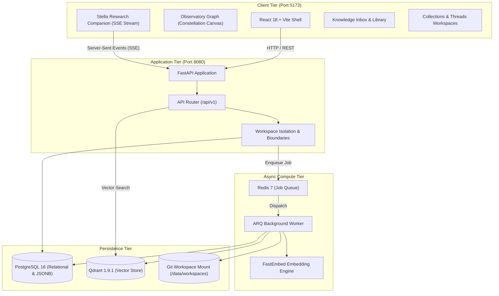

<p align="center">
  
</p>

# Hyades

> A celestial observatory for your thoughts. A personal knowledge graph that maps connections as constellations and grounds research in verified source provenance.

[](CONTRACT_v0.4.2.md)
[](LICENSE)
[](pyproject.toml)
[](backend/pyproject.toml)
[](frontend/package.json)
[](docker-compose.yml)
[](docker-compose.yml)
[](docker-compose.yml)

---

## Table of Contents

- [Overview](#overview)
- [The Problem](#the-problem)
- [Core Workspaces](#core-workspaces)
- [Key Features](#key-features)
- [System Architecture](#system-architecture)
- [Tech Stack](#tech-stack)
- [Installation and Setup](#installation-and-setup)
- [Quickstart and Usage](#quickstart-and-usage)
- [Local Development](#local-development)
- [API Reference](#api-reference)
- [Keyboard Shortcuts](#keyboard-shortcuts)
- [Testing and Quality Verification](#testing-and-quality-verification)
- [Engineering Contracts and Governance](#engineering-contracts-and-governance)
- [Contributing](#contributing)
- [License](#license)

---

## Overview

Hyades (formerly known as Knowledge Atlas) is a full-stack personal knowledge platform built for researchers, engineers, and deep thinkers. While standard note-taking tools act as passive digital filing cabinets and traditional RAG chatbots assemble disconnected text chunks without context, Hyades treats knowledge as an evolving, interconnected graph.

The system pairs an archival design language with modern knowledge engineering:
- Ingest literature across diverse document formats.
- Stage and curate discoveries in a Knowledge Inbox before committing them to the permanent graph.
- Explore spatial concept constellations in the Observatory in real time.
- Conduct multi-turn conversational synthesis with Stella grounded in mathematical source provenance.
- Organize research trajectories into dedicated Collections and inquiry Threads.

The visual identity follows the Ivory Observatory and Scholarly Stoa design system with a clear guiding principle: **Sophisticated World + Simple Interface**. It delivers an editorial reading and research environment free of SaaS card clutter, neon gradients, and ungrounded AI hallucinations.

---

## The Problem

Modern knowledge management suffers from three systemic breakdowns:

1. **Storage without Synthesis:** Notes accumulate into disconnected silos. Months later, finding related ideas requires manual search through scattered folders.

2. **Ungrounded Hallucinations:** Large language models confidently state claims without citations, making verification tedious and unreliable.

3. **Graph Overhead:** Most knowledge-graph tools require tedious manual linking, while fully automatic graph builders clutter databases with noisy, irrelevant entities.

Hyades solves this problem by combining deterministic source provenance, a staging Knowledge Inbox for extraction oversight, reciprocal rank fusion search, and a persistent AI companion named Stella.

---

## Core Workspaces

Hyades organizes intellectual work into dedicated, specialized destinations:

| Workspace | Surface Role | Updated Feature Nomenclature & Capabilities |
| :--- | :--- | :--- |
| **Overview Dashboard** | Central scholarly desk | Displays **Your Knowledge** summary metrics, **Continue Working** active notes, **New Connections** discoveries, **Recent Activity** timeline, and **Knowledge Health** system diagnostics. |
| **Library** | Archival literature archive | Persistent repository of user notes, uploaded sources, literature documents, and cataloged research materials. |
| **Knowledge Inbox** | Ingestion staging gate | Review candidate documents before permanent graph commitment. Inspect dry-run concept previews, adjust titles, and accept or reject items. |
| **Observatory** | Spatial knowledge graph | Interactive celestial canvas visualization (**ConstellationGraph**) featuring level-of-detail culling, semantic topic clustering, and **Saved Views** camera presets. |
| **Stella** | Grounded research companion | Multi-turn conversational AI assistant streaming token-by-token synthesis via SSE with chunk citations and verified similarity scoring. |
| **Collections** | Thematic knowledge groupings | Non-destructive categorization that groups related notes, sources, and concepts together without duplicating files. |
| **Threads** | Inquiry research folios | Structured workspaces centered around an investigation, hypothesis, or open research question with attached evidence and notes. |

---

## Key Features

- **Knowledge Inbox Gate:** Inspect parsed entities and relationships in dry-run mode before accepting or rejecting them into the permanent knowledge graph.

- **Observatory Spatial Constellation Graph:** Canvas-based interactive graph visualization with level-of-detail culling, semantic clustering, and zero idle frame consumption.

- **Saved Observatory Views:** Save and recall filtered graph states, pinned concept sets, and spatial camera viewpoints across research sessions.

- **Stella Research Companion:** Persistent multi-turn AI assistant streaming token-by-token synthesis with verified chunk citations linking directly to source documents.

- **Inquiry Threads & Curated Collections:** Purpose-built workspaces for open research questions, hypotheses, and thematic concept clusters without file duplication.

- **Expanded Multi-Format Ingestion:** Direct parsing pipelines for PDF, Markdown, plaintext, DOCX, EPUB, HTML, JSON, CSV, and image assets.

- **Global Hybrid Search Engine:** Combines dense vector similarity (Qdrant) and lexical keyword matching using Reciprocal Rank Fusion (RRF) for high-precision retrieval.

- **Git-Backed Note Versioning:** Notes are backed by Git repository histories, providing line-level visual diffs and one-click revision rollback.

- **Asynchronous Background Processing:** Heavy extraction, chunking, and indexing operations run non-blockingly via Redis and ARQ background workers with automatic retries.

- **Deterministic Contract Architecture:** Strict specification gates govern models, migrations, endpoints, and cross-workstream handoffs.

---

## System Architecture

The Hyades stack enforces separation of concerns across presentation, API routing, background computation, and persistent storage layers.



---

## Tech Stack

| Layer | Component | Version / Description |
| :--- | :--- | :--- |
| **Frontend** | React, TypeScript | React 18.3, TypeScript 5.7, Vite 5.4 |
| **Styling** | Tailwind CSS | Tailwind CSS 4.0, Phosphor Icons, Lucide React |
| **Visualization** | D3.js, Force Graph | react-force-graph-2d, D3 7.9 |
| **Backend API** | FastAPI, Python | Python 3.12+, FastAPI 0.115+, Pydantic 2.10 |
| **ORM & Migrations** | SQLAlchemy, Alembic | SQLAlchemy 2.0, Psycopg 3.2, Alembic 1.15 |
| **Vector Database** | Qdrant | Qdrant 1.9.1 (pinned collection schema: `{prefix}_{workspace_id}`) |
| **Task Queue** | ARQ, Redis | ARQ 0.26, Redis 7 (stateless transport queue) |
| **Embeddings & LLM** | FastEmbed, Ollama | FastEmbed (local BAAI/bge-small-en-v1.5 default), FreeLLMAPI, Ollama |
| **Versioning** | Git Engine | Local Git tree for note revisions with diff inspection |
| **Testing** | Pytest, Vitest, Playwright | Pytest 8.3, Testcontainers 4.0, Vitest 2.1, Playwright 1.44 |

---

## Installation and Setup

### Prerequisites

Ensure the following tools are available on your development system:

- **Docker & Docker Compose:** Docker Engine 24+ and Docker Compose v2+
- **Python:** Version 3.12 or newer
- **Package Manager for Python:** `uv` (`curl -LsSf https://astral.sh/uv/install.sh | sh`)
- **Node.js:** Version 20.x LTS or newer with `npm`
- **Git:** Version 2.30 or newer

### Step-by-Step Installation

Clone the repository and initialize the root and frontend configuration files:

```bash
# Clone the repository
git clone https://github.com/RehanShaikh-ai/Hyades.git
cd Hyades

# Initialize backend and frontend environment files
cp .env.example .env
cp frontend/.env.example frontend/.env
```

---

## Quickstart and Usage

Launch the full multi-service application with Docker Compose:

### 1. Launch Services via Docker Compose

```bash
docker compose up --build
```

Expected output:

```text
knowledge_atlas_postgres  | PostgreSQL Database directory appears to contain a database; Skipping initialization
knowledge_atlas_postgres  | database system is ready to accept connections
knowledge_atlas_migrate   | INFO  [alembic.runtime.migration] Context impl PostgresqlImpl.
knowledge_atlas_migrate   | INFO  [alembic.runtime.migration] Will assume transactional DDL.
knowledge_atlas_migrate   | INFO  [alembic.runtime.migration] Running upgrade -> head
knowledge_atlas_migrate exited with code 0
knowledge_atlas_redis     | Ready to accept connections tcp
knowledge_atlas_qdrant    | Qdrant HTTP listening on 6333
knowledge_atlas_backend   | INFO:     Application startup complete.
knowledge_atlas_backend   | INFO:     Uvicorn running on http://0.0.0.0:8080 (Press CTRL+C to quit)
knowledge_atlas_worker    | Registered worker tasks: index_source, extract_entities, reindex_workspace
knowledge_atlas_frontend  |   VITE v5.4.14  ready in 280 ms
knowledge_atlas_frontend  |   ->  Local:   http://localhost:5173/
```

### 2. Verify System Health

Verify that all subsystems are responsive:

```bash
curl -s http://localhost:8080/api/v1/health
```

Expected output:

```json
{"status":"healthy","database":"connected","version":"0.4.2"}
```

Open your browser to:
- **Application Interface:** `http://localhost:5173`
- **Interactive OpenAPI Documentation:** `http://localhost:8080/docs`

---

## Local Development

For workflows where you run backend and frontend runtimes directly on the host machine:

### 1. Start Infrastructure Services

Start PostgreSQL, Redis, and Qdrant in detached mode:

```bash
docker compose up -d postgres redis qdrant
```

### 2. Configure and Run Backend

```bash
# Navigate to backend directory
cd backend

# Sync dependencies with uv
uv sync

# Run database migrations
uv run alembic upgrade head

# Start FastAPI development server with reload
uv run python -m uvicorn app.main:app --reload --port 8080
```

Expected output:

```text
INFO:     Will watch for changes in: ['/home/user/Hyades/backend/app']
INFO:     Uvicorn running on http://127.0.0.1:8080 (Press CTRL+C to quit)
INFO:     Started reloader process [14820] using WatchFiles
INFO:     Started server process [14822]
INFO:     Waiting for application startup.
INFO:     Application startup complete.
```

### 3. Start Background Worker

In a separate terminal, launch the ARQ indexing worker:

```bash
cd backend
uv run arq app.jobs.worker.WorkerSettings
```

### 4. Configure and Run Frontend

In a third terminal, start Vite:

```bash
# Navigate to frontend directory
cd frontend

# Install packages
npm install

# Start development server
npm run dev
```

Expected output:

```text
  VITE v5.4.14  ready in 214 ms

  ->  Local:   http://localhost:5173/
  ->  Network: http://0.0.0.0:5173/
```

---

## API Reference

The backend exposes a versioned RESTful API under `/api/v1`. Full schema definitions and interactive requests are available at `http://localhost:8080/docs`.

### Core Endpoints Summary

| Method | Endpoint | Feature & Description |
| :--- | :--- | :--- |
| `GET` | `/api/v1/health` | System and database health status |
| `GET` | `/api/v1/workspaces` | List accessible workspaces |
| `POST` | `/api/v1/workspaces` | Create a new isolated workspace |
| `GET` | `/api/v1/workspaces/{id}/dashboard` | Fetch **Overview Dashboard** metrics (Your Knowledge, Activity, Health) |
| `POST` | `/api/v1/workspaces/{id}/notes` | Create a markdown note in the **Library** |
| `GET` | `/api/v1/notes/{id}` | Retrieve note metadata and content |
| `GET` | `/api/v1/notes/{id}/versions` | Inspect **Git Version History** of a note |
| `POST` | `/api/v1/notes/{id}/versions/{version_id}/restore` | Rollback note to target Git commit |
| `POST` | `/api/v1/workspaces/{id}/sources/upload` | Ingest external document into workspace |
| `GET` | `/api/v1/workspaces/{id}/inbox` | List staged documents in **Knowledge Inbox** |
| `POST` | `/api/v1/inbox/{id}/accept` | Accept staged item from Inbox into **Observatory Graph** |
| `POST` | `/api/v1/inbox/{id}/reject` | Reject and delete staged source, chunks, and embeddings |
| `GET` | `/api/v1/workspaces/{id}/collections` | List curated **Collections** |
| `POST` | `/api/v1/workspaces/{id}/collections` | Create a new thematic **Collection** |
| `GET` | `/api/v1/workspaces/{id}/threads` | List active inquiry **Threads** |
| `POST` | `/api/v1/workspaces/{id}/threads` | Open a new research inquiry **Thread** |
| `POST` | `/api/v1/workspaces/{id}/search` | Execute **Global Hybrid Search** (Semantic + Lexical) |
| `POST` | `/api/v1/workspaces/{id}/conversations` | Create a conversation session with **Stella** |
| `POST` | `/api/v1/conversations/{id}/messages` | Send prompt to **Stella** with streaming SSE response |
| `GET` | `/api/v1/workspaces/{id}/graph` | Retrieve **Observatory** graph data (Concepts, Connections, Clusters) |
| `POST` | `/api/v1/workspaces/{id}/saved-views` | Persist an **Observatory Saved View** and camera viewpoint |

---

## Keyboard Shortcuts

Hyades provides global shortcuts for distraction-free navigation. Rather than abstract modifier keys, shortcuts support explicit platform bindings across Windows, Linux, and macOS:

| Action | Windows Key Binding | Linux Key Binding | macOS Key Binding | Scope |
| :--- | :--- | :--- | :--- | :--- |
| **Global Quick Search** | `Ctrl + K` or `Windows + Space` | `Ctrl + K` or `Super + Space` | `Cmd + K` or `Cmd + Space` | Whole Application |
| **Summon Stella Assistant** | `Ctrl + J` or `Windows + J` | `Ctrl + J` or `Super + J` | `Cmd + J` | Research Companion |
| **Compose New Note** | `Ctrl + N` or `Windows + N` | `Ctrl + N` or `Super + N` | `Cmd + N` | Library & Overview |
| **Dismiss Active Modal** | `Escape` | `Escape` | `Escape` | Modals, Palette & Editor |

Platform key mappings:
- **Windows Users:** Use the **Windows key** (Win) or `Ctrl`.
- **Linux Users:** Use the **Super key** (Super) or `Ctrl`.
- **macOS Users:** Use the **Command key** (`Cmd`).

---

## Testing and Quality Verification

Hyades uses a three-tier testing strategy covering unit behavior, database schema transitions, and end-to-end browser journeys.

### 1. Database Schema and Migration Drift Gate

Verify that migrations apply cleanly from scratch and report zero model drift:

```bash
uv run python scripts/verify_migrations.py
uv run alembic check
```

Expected output:

```text
INFO: Migration verification successful. Schema is fully aligned with models.
No new upgrade operations detected.
```

### 2. Backend Unit and Integration Suites

Run backend tests using Pytest and Testcontainers:

```bash
# Run backend contract and unit tests
uv run pytest backend/tests -v

# Run integration suite with isolated PostgreSQL container
uv run pytest tests/integration -v
```

Expected output:

```text
======================= 48 passed in 12.34s =======================
```

### 3. Frontend Unit and Component Tests

Execute frontend tests using Vitest:

```bash
cd frontend
npm run test
```

Expected output:

```text
 [PASS] src/components/Observatory.test.tsx (4)
 [PASS] src/components/StellaChat.test.tsx (6)
Test Files  2 passed (2)
     Tests  10 passed (10)
```

### 4. End-to-End Playwright Validation

Validate critical user journeys including document ingestion, citation verification, and session persistence:

```bash
docker compose --profile e2e run playwright
```

Expected output:

```text
Running 14 tests using 2 workers
  14 passed (18.2s)
```

---

## Engineering Contracts and Governance

Hyades is engineered under strict **Contract-Driven Development**. Feature scope, database schemas, and API payloads are formally specified and approved before implementation begins.

- **Current Active Contract:** [CONTRACT_v0.4.2.md](CONTRACT_v0.4.2.md) (*Collections, Threads & Working Knowledge*)
- **Historical Contracts:** Located in [docs/contracts/](docs/contracts/)
- **Visual Design Identity:** Documented in [DESIGN.md](DESIGN.md)
- **Local Tooling and Recovery Guide:** Documented in [docs/SETUP.md](docs/SETUP.md)

### Strict Handoff Gates

1. **Schema Handoff Gate:** Model definitions must be merged in `schema-handoff/v0.4.2` before any Alembic migrations are written.
2. **Compose Lock:** Modifications to `docker-compose.yml` require a Compose Change Notice.
3. **Migration Drift Gate:** CI fails if `alembic check` detects differences between SQLAlchemy models and the active schema.
4. **API Conformance:** Endpoints and payload contracts cannot be changed unilaterally.

---

## Contributing

The Hyades engineering team operates across three distinct workstreams:

| Workstream | Lead | Responsibility Boundary |
| :--- | :--- | :--- |
| **Workstream A (Frontend)** | Hamza | React application, UI components, Observatory canvas, Stella chat, Playwright tests |
| **Workstream B (Backend)** | Ali | FastAPI routes, SQLAlchemy models, Pydantic schemas, ARQ background workers, vector search |
| **Workstream C (Infra & DB)** | Rehan | Docker Compose, Alembic migrations, CI/CD pipelines, integration test harness, documentation |

### Branch Conventions

Branch names follow workstream ownership:

```bash
frontend/<feature-description>
backend/<feature-description>
infra/<feature-description>
```

All modifications require pull request approval from the relevant workstream lead before merging into `main`.

---

## License

This project is licensed under the terms of the MIT License.

```text
MIT License

Copyright (c) 2026 Rehan Shaikh, Hamza Qureshi & Mohammed Ali Bubere

Permission is hereby granted, free of charge, to any person obtaining a copy
of this software and associated documentation files (the "Software"), to deal
in the Software without restriction, including without limitation the rights
to use, copy, modify, merge, publish, distribute, sublicense, and/or sell
copies of the Software, and to permit persons to whom the Software is
furnished to do so, subject to the following conditions:

The above copyright notice and this permission notice shall be included in all
copies or substantial portions of the Software.
```

See the full [LICENSE](LICENSE) file for details.